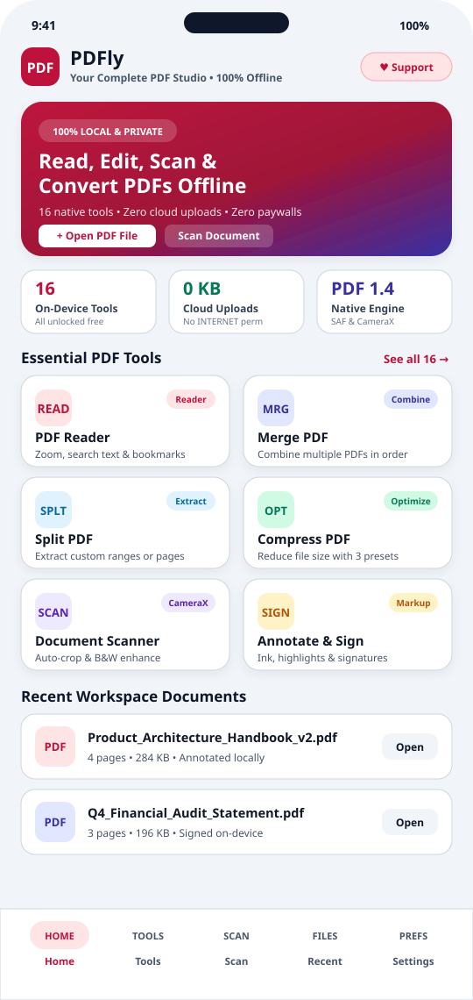
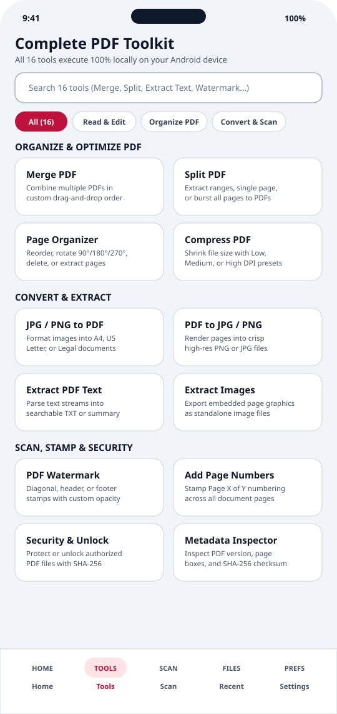
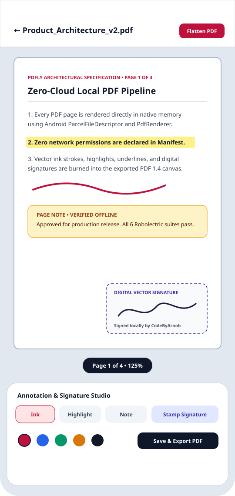
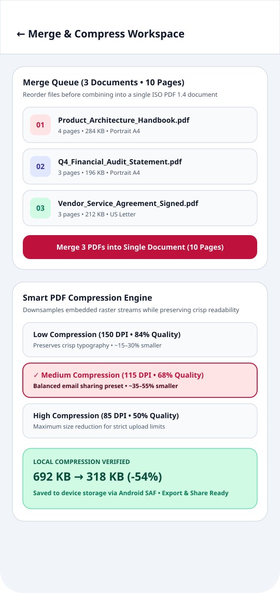
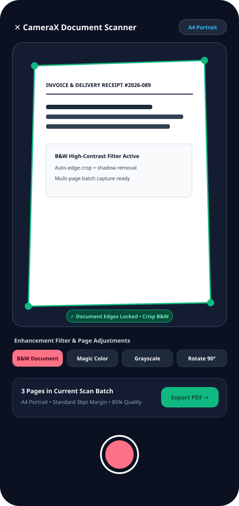
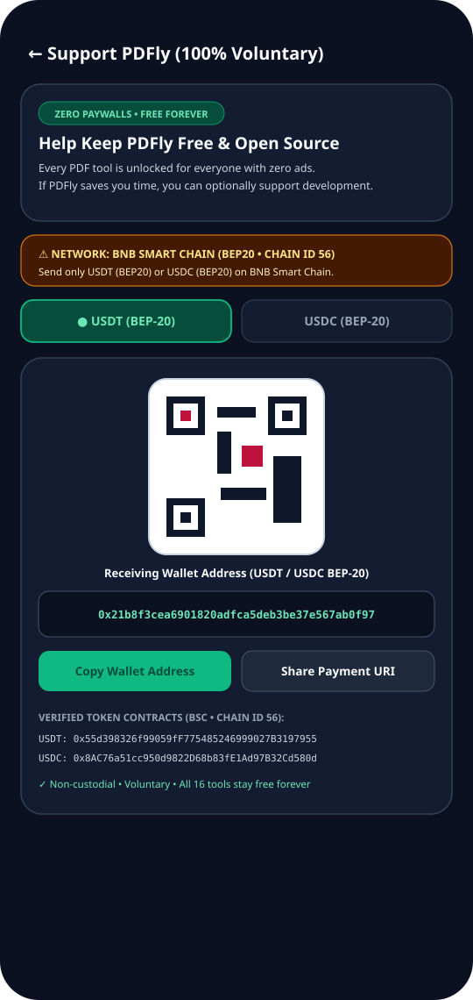

<div align="center">

# PDFly — PDF Editor & Toolkit

**Your Complete PDF Studio for Android — 100% Free, 100% Offline, Open Source**

[](https://github.com/CodeByArnob/PDFly/blob/main/LICENSE)
[-3DDC84.svg)](https://github.com/CodeByArnob/PDFly)
[](https://kotlinlang.org/)
[](https://developer.android.com/jetpack/compose)
[](#privacy--security-model)

[**Official Website (`codebyarnob.github.io/PDFly`)**](https://codebyarnob.github.io/PDFly/) • [**Download APK (Releases)**](https://github.com/CodeByArnob/PDFly/releases) • [**Report Issue**](https://github.com/CodeByArnob/PDFly/issues) • [**Maintained by @CodeByArnob**](https://github.com/CodeByArnob)

</div>

---

## Overview

**PDFly** (`com.aistudio.pdfly.toolkit`) is a complete, privacy-first, offline native Android PDF productivity suite built with **Kotlin**, **Jetpack Compose**, **Material Design 3**, **MVVM / Clean Architecture**, **Room Database**, **Jetpack DataStore**, **CameraX**, and a native **ISO PDF 1.4 (`PdfRenderer` / `PdfDocument` / `IsoPdf14Codec`)** processing engine.

Every single PDF tool in PDFly is **100% free forever**—with no subscriptions, no locked tools, no trial limits, no mandatory accounts, and no advertisements.

---

## App Screenshots

<p align="center">
  
  
  
</p>
<p align="center">
  
  
  
</p>

---

## Complete 16-Tool On-Device PDF Toolkit

All 16 PDF tools execute locally on the user's Android device:

### 1. Read & Edit
- **PDF Reader**: Smooth multi-page rendering, pinch-to-zoom, page jump slider, keyword search, and persistent bookmarks.
- **PDF Annotation**: Freehand vector ink (rotation-aware across `0°`/`90°`/`180°`/`270°`), text highlights, underlines, and page sticky notes flattened directly into exported PDFs.
- **Add Signature**: Draw handwritten vector signatures or create styled signatures, store them in the local signature vault, and stamp them onto any page.

### 2. Organize & Optimize PDF
- **Merge PDF**: Combine multiple PDF documents in custom order into a single file while preserving each source page's exact dimensions.
- **Split PDF**: Extract custom page ranges (e.g., `1-3, 5`), extract a single page, or burst every page into individual PDF files.
- **Page Organizer**: Reorder pages, rotate individual sheets (`90°`/`180°`/`270°`), delete unwanted pages, or extract selected pages.
- **Compress PDF**: Reduce file size locally using calibrated **Low (150 DPI, 84% Q)**, **Medium (115 DPI, 68% Q)**, or **High (85 DPI, 50% Q)** presets with before-and-after size reporting.

### 3. Convert & Extract
- **JPG / PNG to PDF**: Convert photos and graphics into formatted **A4**, **US Letter**, or **US Legal** PDFs with configurable orientation and margins.
- **PDF to JPG / PNG**: Render and export PDF pages into high-resolution lossless PNG or compact JPG image files.
- **Extract PDF Text**: Parse and export selectable PDF text streams into clean `.txt` files or structured summaries.
- **Extract Images**: Export rendered page visuals and embedded document graphics as standalone image files.

### 4. Scan & Stamp
- **CameraX Document Scanner**: Capture physical pages with Android CameraX, auto-crop document boundaries, and apply **B&W Document**, **Magic Color**, or **Grayscale** filters.
- **PDF Watermark**: Stamp custom diagonal, header, or footer text watermarks with adjustable opacity and point size.
- **Add Page Numbers**: Insert formatted page numbers (`Page X of Y`, `X / Y`, `- X -`, `X`) across all pages.

### 5. Security & Utilities
- **PDF Security & Unlock**: Apply local access protection metadata with SHA-256 verification or unlock authorized PDF documents.
- **PDF Metadata Inspector**: Inspect PDF specification version, exact page dimensions in points, SHA-256 checksum, encryption status, and document properties.

---

## Privacy & Security Model

- **Zero Network Permission**: PDFly does **not** request `android.permission.INTERNET` in `AndroidManifest.xml`. It is physically impossible for the app to upload your documents to any server.
- **Zero Broad Storage Permissions**: File import and export use Android's **Storage Access Framework (`ActivityResultContracts.OpenDocument` / `CreateDocument`)** and **Android Photo Picker (`PickMultipleVisualMedia`)**.
- **Scoped Camera Access**: `android.permission.CAMERA` is requested strictly when launching the CameraX Document Scanner.
- **OOM-Safe Native Processing**: Uses sampled bitmap decoding (`inSampleSize`) and immediate `Bitmap.recycle()` cleanup for multi-page PDF operations.

---

## Repository Architecture

```text
PDFly/
├── app/                                      # Native Android Application (Kotlin + Jetpack Compose)
│   └── src/main/java/com/example/
│       ├── core/
│       │   ├── filemanager/LocalFileManager.kt       # SAF import/export, path sanitization & cache cleanup
│       │   ├── processing/PdfProcessingEngine.kt     # 16-tool local PDF engine (Merge, Split, Compress, Scan, Sign)
│       │   ├── processing/IsoPdf14Codec.kt           # Native ISO PDF 1.4 parser, stream compressor & writer
│       │   └── qrcode/QrCodeGenerator.kt             # Pure-Kotlin ISO/IEC 18004 QR Code matrix generator
│       ├── data/
│       │   ├── local/PdflyDatabase.kt                # Room database (Documents, History, Annotations, Signatures)
│       │   ├── local/UserPreferencesManager.kt       # Jetpack DataStore preferences (Theme, Defaults, Cold-Start)
│       │   └── repository/PdflyRepository.kt         # Single-source-of-truth reactive repository
│       ├── domain/model/PdflyModels.kt               # Domain models, tool catalog & BNB Smart Chain token catalog
│       ├── feature/
│       │   ├── splash/CinematicSplashScreen.kt       # Choreographed 4-stage vector splash screen
│       │   ├── dashboard/DashboardScreen.kt          # Editorial Home Studio Dashboard
│       │   ├── tools/ToolsGridScreen.kt              # 16-Tool searchable catalog
│       │   ├── tools/ToolWorkspaceScreen.kt          # Functional motion tool execution workspace
│       │   ├── reader/PdfReaderScreen.kt             # PDF Reader, Annotation & Vector Signature Studio
│       │   ├── scanner/DocumentScannerScreen.kt      # CameraX Document Scanner & filter studio
│       │   ├── recent/RecentFilesScreen.kt           # Recent, Favorites & Processing History manager
│       │   ├── donation/SupportDonationScreen.kt     # Voluntary USDT/USDC (BEP-20) open-source support screen
│       │   └── settings/SettingsAndAboutScreen.kt    # Theme switcher, cache manager, Privacy & About screens
│       └── ui/theme/                                 # WCAG 2.2 AA+ Editorial Light & Obsidian Dark themes
├── website/                                  # Official Marketing & Documentation Website (React + Vite + TS)
│   ├── public/screenshots/                   # High-DPI SVG Android app screen previews
│   └── src/                                  # Interactive 16-tool showcase, workflow simulator & docs
├── docs/screenshots/                         # Repository documentation screenshots
└── .github/workflows/                        # Android CI & GitHub Pages deployment workflows
```

---

## Building & Testing from Source

### Prerequisites
- **JDK 17**
- **Android SDK (API 36)** / Android Studio Ladybug or newer
- **Node.js 22+** (for building `/website`)

### 1. Run Android Unit & Robolectric Tests
```bash
./gradlew :app:testDebugUnitTest
```

### 2. Assemble Android Debug APK
```bash
./gradlew :app:assembleDebug
```
The compiled APK will be generated at `app/build/outputs/apk/debug/app-debug.apk`.

### 3. Run & Build the Official Website (`/website`)
```bash
cd website
npm install
npm run dev      # Start local dev server
npm run build    # Build production static bundle into website/dist/
```

---

## GitHub Pages Deployment (`https://codebyarnob.github.io/PDFly/`)

This repository includes an automated GitHub Actions workflow (`.github/workflows/deploy-website.yml`) that builds `/website` and deploys `./website/dist` to **GitHub Pages**.

To enable or verify GitHub Pages in repository settings:
1. Open **Settings → Pages** in `https://github.com/CodeByArnob/PDFly`.
2. Under **Build and deployment → Source**, select **GitHub Actions**.
3. Any push to `main` touching `website/**` (or manual trigger via **Actions → Deploy Official Website to GitHub Pages → Run workflow**) will automatically publish the site to `https://codebyarnob.github.io/PDFly/`.

---

## Support PDFly (100% Voluntary)

PDFly is completely free and open source with zero paywalls, zero subscriptions, and zero ads. If PDFly saves you time and you would like to voluntarily support ongoing development, you can contribute **USDT (BEP-20)** or **USDC (BEP-20)** on **BNB Smart Chain (BSC • Chain ID 56)**:

- **Network**: `BNB Smart Chain (BEP20 • Chain ID 56)`
- **Receiving Wallet Address (`USDT` & `USDC` BEP-20)**:
  ```text
  0x21b8f3cea6901820adfca5deb3be37e567ab0f97
  ```
- **Verified USDT (BSC-USD BEP-20) Contract**: `0x55d398326f99059fF775485246999027B3197955`
- **Verified USDC (Binance-Peg USDC BEP-20) Contract**: `0x8AC76a51cc950d9822D68b83fE1Ad97B32Cd580d`

> **Important**: Please send only `USDT (BEP20)` or `USDC (BEP20)` on the **BNB Smart Chain (BEP20)** network.

---

## License & Author

- **Author & Maintainer**: [**CodeByArnob**](https://github.com/CodeByArnob)
- **Repository**: [`https://github.com/CodeByArnob/PDFly`](https://github.com/CodeByArnob/PDFly)
- **License**: Released under the [MIT License](LICENSE).
